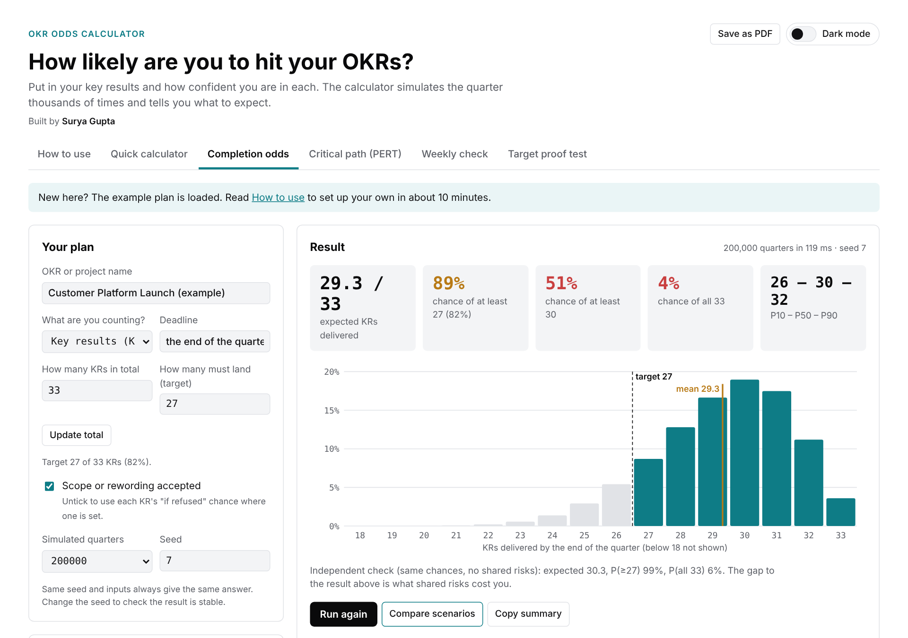
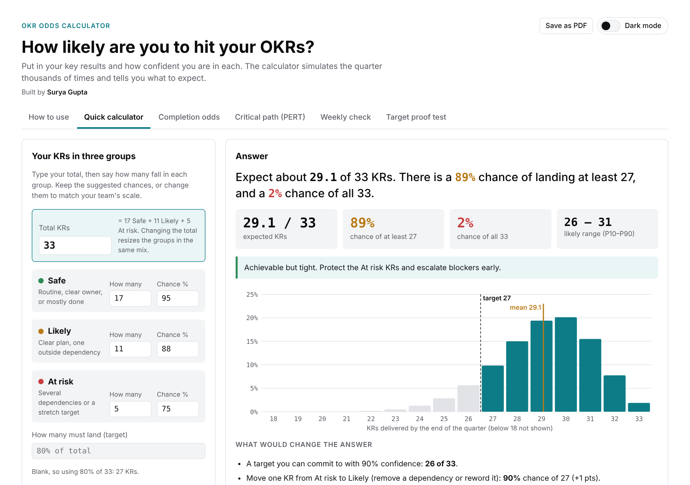
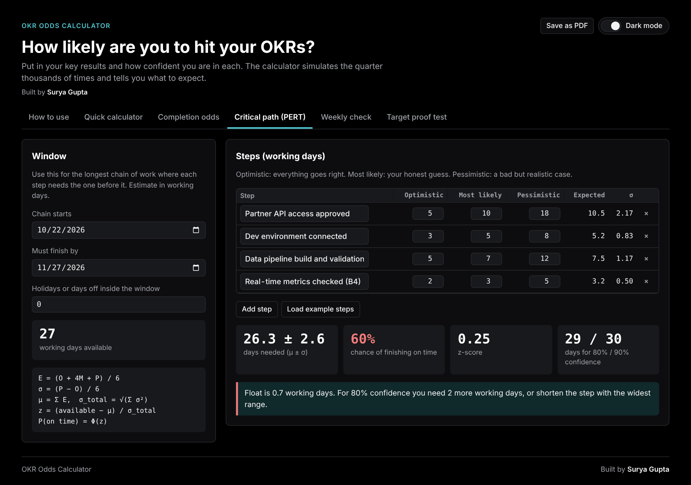

# OKR Odds Calculator

**How likely are we to actually hit our OKRs?** A single-file, offline calculator that turns your team's confidence in each key result into an honest forecast, using Monte Carlo simulation, PERT and exact binomial statistics.

No install. No sign-up. No AI. No data leaves your browser.

Built by **Surya Gupta**.



---

## Why this exists

Plans say "all 33 KRs by the end of the quarter". Reality is a range. Most OKR reviews report a single traffic-light status, which hides two things that matter:

1. **How likely the target really is**, given how uncertain each KR is.
2. **Shared risks.** One late dependency, such as API access, a licence or a key person, can sink several KRs at once.

This tool makes both visible in a way that leaders, delivery teams and analysts can all read. It lets you say:

> "We played out the quarter 200,000 times using our own confidence in each KR. We expect 29 of 33, with an 89% chance of hitting our 80% target. Fixing the API access risk is worth +0.7 KRs."

It works for any OKR, project, sprint or delivery plan: anything with a list of items and a deadline.

---

## What's inside

Six tabs in one HTML file:

| Tab | Question it answers | Method |
|---|---|---|
| **How to use** | How do I set this up? | Built-in guide, confidence scale and glossary |
| **Quick calculator** | Roughly, are we OK? | Sort KRs into Safe, Likely and At risk. Exact calculation, instant answer |
| **Completion odds** | How many KRs will we land, and what's the chance of hitting the target? | Monte Carlo simulation with correlated shared risks |
| **Critical path (PERT)** | Will the longest chain of dependent work finish in time? | PERT three-point estimates with a normal approximation |
| **Weekly check** | We finished 5 of 8 tasks this week. Should I escalate? | Exact binomial hypothesis test |
| **Target proof test** | Does our sample prove we hit 40%? | Exact binomial test with a Wilson 95% confidence interval |

### Features

- **Your own plan:** edit, add or remove KRs inline, set a total in one click, or paste rows straight from Excel or Google Sheets.
- **Shared risks:** model things that hit several KRs at once, with how much each one hurts each KR. A risk can also be a KR itself.
- **Scenario comparison:** re-run with each risk removed to see which one is worth fixing first.
- **Scope toggle:** compare "rewording accepted" against "rewording refused" for stretch KRs.
- **Count anything:** label the rows as key results, tasks, deliverables or items.
- **Plain-language output:** a one-line answer, a red, amber or green verdict, and "what would change the answer" suggestions.
- **Copy summary:** paste-ready text for email, Teams or Slack.
- **Share setups as text:** copy your whole setup and send it to a colleague, who pastes it in to load it.
- **Save as PDF:** a clean white report with the answer first.
- **Dark and light themes** with a switch.
- **Works offline** and on mobile.
- **Autosaves** in your browser.

---

## Quick start

1. Download `index.html` (the green **Code** button → **Download ZIP**, or open the file and choose **Download raw file**).
2. Double-click it to open it in Chrome, Edge, Firefox or Safari.
3. A made-up example, a 33-KR "Customer Platform Launch", is loaded. Open **How to use** for a 10-minute walkthrough, or go straight to **Quick calculator**.

That's it. There's no build step, no server and nothing to install.

**Hosting for a team (optional):** enable GitHub Pages on this repo (Settings → Pages → deploy from the `main` branch) and share the URL. Each person's data still stays in their own browser.

---

## Screenshots

| Quick calculator | Critical path (PERT), dark mode |
|---|---|
|  |  |

---

## How it works

### Completion odds: Monte Carlo simulation

Each KR is treated as a weighted coin: a 90% KR lands "done" 90% of the time. For each simulated quarter:

```
each shared risk r goes well with probability P(r)
for each KR k:
    p = chance_k                          (or the "if refused" chance when scope is refused)
    if k is tied to risk r:  p = 1 if r went well, else 0
    for each risk r that went badly:  p = p × kept_k,r
    KR k lands with probability p
X = number of KRs landed
```

Repeat N times (default 200,000), then count:

- **Expected** = the average of X.
- **P(X ≥ target)** = the share of quarters that hit the target.
- **P10 / P50 / P90** = the 10th, 50th and 90th percentiles of X.

Shared risks are drawn once per quarter, so KRs that depend on the same thing slip together, just like in real life. An exact **Poisson-binomial** calculation with no shared risks is shown next to the result, so you can see what the correlation costs you.

**Accuracy:** with 200,000 runs, the standard error of a percentage is √(p(1−p)/N). For p = 0.89 that's about 0.07 percentage points, so the 95% margin is about ±0.14 points. A seeded random number generator (mulberry32) makes results exactly reproducible.

### Quick calculator: exact Poisson-binomial

The KRs are grouped into three confidence bands. The distribution of KRs landed is computed exactly by convolution. With one shared risk it's a mixture:

```
P(X = x) = P(risk OK) · PB(x | p_i) + P(risk fails) · PB(x | p_i × kept_i)
```

### Critical path: PERT

```
E   = (O + 4M + P) / 6           expected time for one step
σ   = (P − O) / 6                uncertainty for one step
μ   = Σ E                        total expected time
σ_t = √(Σ σ²)                    total uncertainty
z   = (available − μ) / σ_t
P(on time) = Φ(z)                standard normal CDF
```

Working days between two dates are counted excluding weekends, with an optional allowance for holidays.

### Weekly check: binomial test

H₀: the team is on plan, so each planned task finishes with probability p₀.
p-value = P(X ≤ done | n, p₀). Escalate if the p-value ≤ α (default 0.05). The tool also shows a threshold table for 3 to 20 planned tasks.

### Target proof test: exact binomial test with a Wilson interval

H₀: the true rate ≤ the target.
p-value = P(X ≥ conforming | n, target). The minimum conforming count needed to prove the target is shown for common sample sizes, along with a Wilson 95% confidence interval for the observed rate.

---

## Validation

The outputs have been checked against SciPy and NumPy:

| Check | Calculator | SciPy / NumPy |
|---|---|---|
| Weekly check: 5 of 8 done, p₀ = 0.9 | p = 0.038, escalate below 6 | 0.038, 6 |
| Proof test: 47 of 100 vs 40% | p = 0.093, need 49, CI 38–57% | 0.093, 49, 38–57% |
| PERT example chain, 27 days available | 26.3 ± 2.6 days, 60%, 29 / 30 days | 26.3, 2.6, 60%, 29 / 30 |
| Quick calculator default | 29.1 expected, 89%, 2% | 29.1, 89%, 2% |
| Monte Carlo example plan (seed 7) | 29.3 expected, 89% ≥ 27 | matches a reference Python implementation of the same model |

A 68-check automated browser test, run with Playwright on Chromium, covered every tab, button and edge case, plus theme switching, PDF output, autosave and phone-width layout. All checks passed.

To reproduce the binomial and PERT figures yourself:

```python
from scipy import stats
import math

print(stats.binom.cdf(5, 8, 0.9))                       # weekly check p-value -> 0.038
print(stats.binom.sf(46, 100, 0.4))                     # proof test p-value -> 0.093
print(stats.binomtest(47, 100).proportion_ci(method="wilson"))

steps = [(5, 10, 18), (3, 5, 8), (5, 7, 12), (2, 3, 5)]
mu = sum((o + 4*m + p) / 6 for o, m, p in steps)
sd = math.sqrt(sum(((p - o) / 6) ** 2 for o, m, p in steps))
print(mu, sd, stats.norm.cdf((27 - mu) / sd))           # 26.3, 2.6, 0.60
```

---

## Privacy

- Everything runs **locally in your browser** as plain JavaScript.
- **No AI, no API calls, no analytics, no tracking.**
- Your setup is saved only in your own browser (`localStorage`). Clearing site data removes it.
- Setups are only shared when you choose to: you copy the text and send it to someone.
- The only network request is for Google Fonts (IBM Plex). If it's blocked or you're offline, the page falls back to system fonts and works the same.

---

## Choosing good inputs

The maths is exact, but **the forecast is only as good as the chances you enter.** Agree a scale as a team:

| Chance | Use it when |
|---|---|
| 95–98% | Routine or already mostly done |
| 90% | Clear plan, clear owner, no outside dependency |
| 80–85% | Depends on one other team, a licence or a sign-off you don't control |
| 70–75% | Several dependencies, or a stretch from today's baseline |
| ≤ 60% | Needs things to go right that have gone wrong before; consider rewording |

Update the chances weekly as evidence comes in. Treat the tool as a planning aid, not a performance measure. If low chances are punished, people inflate them and the forecast becomes useless.

---

## Limitations

- Shared risks are binary for the whole period (they either go well or badly). Partial slips are approximated with the "kept if fails" percentage.
- PERT assumes steps run one after another and are independent, and that the total is roughly normal.
- Binomial tests assume independent tasks and a random sample.
- Simulation results carry a small random error (about ±0.14 points at 200,000 runs). Change the seed to check stability.
- **Save as PDF** uses the browser's print dialog. It works when the file is opened directly, but not inside sandboxed viewers that block printing.

---

## Project structure

```
.
├── index.html      # the entire app: HTML, CSS and JavaScript, no dependencies
├── docs/           # screenshots used in this README
├── README.md
└── LICENSE
```

The app is deliberately a single file, so it can be emailed, dropped on SharePoint, or hosted on GitHub Pages without a build.

---

## Ideas for the future

- Import and export as CSV
- Multiple shared-risk states (on time, late, very late)
- Track the forecast trend week to week
- Jira import for task-level forecasting

Contributions and issues are welcome.

---

## Contributing

1. Fork the repo and create a branch.
2. Edit `index.html`. Keep it a single file with no build step and no external libraries.
3. If you change the maths, add the matching SciPy or NumPy check to the Validation section.
4. Open a pull request describing the change.

---

## License

MIT. Free to use, modify and share. See `LICENSE`.

---

**Built by Surya Gupta.** If you use it in your team, I'd love to hear how.
